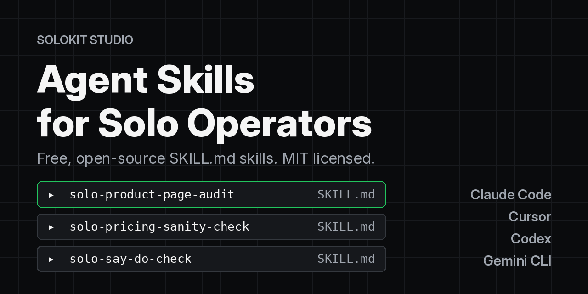

# Agent Skills for Solo Operators

[](https://github.com/SolokitStudio/agent-skills/actions/workflows/ci.yml)
[](LICENSE)
[](https://agentskills.io)
[](#compatibility)



Three free, open-source skills that make your AI coding agent useful for the business side of a one-person company: why a product page isn't selling, whether a price makes sense, and whether the work an agent says it did actually happened.

Each skill is a folder with a `SKILL.md` file in the open [Agent Skills](https://agentskills.io) format. Install once and the same files work in Claude Code, Cursor, Codex and Gemini CLI.

```bash
curl -fsSL https://raw.githubusercontent.com/SolokitStudio/agent-skills/main/install.sh | bash
```

## Skills

| Skill | Use it when | You get |
|---|---|---|
| [`solo-product-page-audit`](skills/solo-product-page-audit/SKILL.md) | A Gumroad, Shopify, Notion Marketplace or landing page gets visits but no sales | A 10-point scorecard with quoted evidence, and fixes ranked by impact and effort, with rewritten copy |
| [`solo-pricing-sanity-check`](skills/solo-pricing-sanity-check/SKILL.md) | You're unsure what to charge, or how to price a bundle or launch code | The buyer's alternative, sourced comparables, a catalog-fit check, and one recommended price |
| [`solo-say-do-check`](skills/solo-say-do-check/SKILL.md) | An agent, contractor or status report says "done" | Every claim graded Verified, Contradicted, Partial or Unverified, plus a status line that's safe to repeat |

Every skill follows the same rules: it asks for missing inputs instead of guessing, never invents numbers, quotes or links, says what it could not check, marks gaps as `[[PLACEHOLDER: ...]]`, and only drafts. It never sends, posts, buys or refunds anything for you.

## Install

### One command (macOS, Linux, WSL)

```bash
curl -fsSL https://raw.githubusercontent.com/SolokitStudio/agent-skills/main/install.sh | bash
```

This installs for your user account, for all four tools. Real output:

```text
Downloading SolokitStudio/agent-skills (main)
-> /Users/you/.claude/skills
  installed solo-pricing-sanity-check
  installed solo-product-page-audit
  installed solo-say-do-check
-> /Users/you/.agents/skills
  installed solo-pricing-sanity-check
  installed solo-product-page-audit
  installed solo-say-do-check
Done: 3 skills, 2 location(s): 6 installed, 0 skipped (tool: all, scope: user).
Start a new agent session to load them. Try: /solo-product-page-audit
```

Claude Code reads `~/.claude/skills`. Codex, Gemini CLI and Cursor read `~/.agents/skills`. Cursor also reads `~/.claude/skills`, so it may list each skill twice; use `--tool cursor` if that bothers you.

Pass options after `bash -s --`:

```bash
# One tool only: claude, cursor, codex or gemini
curl -fsSL https://raw.githubusercontent.com/SolokitStudio/agent-skills/main/install.sh | bash -s -- --tool cursor

# Into one project instead of your user account
curl -fsSL https://raw.githubusercontent.com/SolokitStudio/agent-skills/main/install.sh | bash -s -- --scope project --dir ~/code/my-shop

# See what would happen first
curl -fsSL https://raw.githubusercontent.com/SolokitStudio/agent-skills/main/install.sh | bash -s -- --dry-run
```

The installer never overwrites an existing folder unless you pass `--force`, and `--uninstall` removes only the skills in this repo. Read [`install.sh`](install.sh) before you run it; it is short.

### Claude Code plugin

This repo is also a Claude Code plugin marketplace. In Claude Code:

```text
/plugin marketplace add SolokitStudio/agent-skills
/plugin install solokit-agent-skills@solokit
```

Use either the plugin or `install.sh` for Claude Code, not both, or the skills will load twice.

### From a clone

```bash
git clone https://github.com/SolokitStudio/agent-skills.git
cd agent-skills
./install.sh --help
./install.sh --link      # symlink, so `git pull` updates your installed skills
```

### Manual install

Copy each folder in [`skills/`](skills/) into the folder your tool reads:

| Tool | User scope (all projects) | Project scope (one repo) | Docs |
|---|---|---|---|
| Claude Code | `~/.claude/skills/` | `.claude/skills/` | [code.claude.com/docs/en/skills](https://code.claude.com/docs/en/skills) |
| Cursor | `~/.cursor/skills/` (also reads `~/.agents/skills/`, `~/.claude/skills/`) | `.cursor/skills/` or `.agents/skills/` | [cursor.com/docs/skills](https://cursor.com/docs/skills) |
| Codex (CLI, IDE, app) | `~/.agents/skills/` | `.agents/skills/` | [developers.openai.com/codex/skills](https://developers.openai.com/codex/skills) |
| Gemini CLI | `~/.gemini/skills/` or `~/.agents/skills/` | `.gemini/skills/` or `.agents/skills/` (folder must be trusted) | [geminicli.com/docs/cli/skills](https://geminicli.com/docs/cli/skills) |

On Windows without WSL, copy the folders into `%USERPROFILE%\.claude\skills\` (Claude Code) or `%USERPROFILE%\.agents\skills\` (Codex, Gemini CLI, Cursor).

Uninstall with `./install.sh --uninstall`, or delete the three `solo-*` folders.

## Use

Start a new agent session after installing. You don't need a special command: the agent reads each skill's description and loads the full instructions when your request matches, for example "people visit my Gumroad page but nobody buys, here's the link".

To call a skill by name:

| Tool | How |
|---|---|
| Claude Code, Cursor | `/solo-product-page-audit` |
| Codex | `$solo-product-page-audit`, or `/skills` to list |
| Gemini CLI | `/skills list`, then ask; `/skills reload` picks up new skills |

## Example

An agent was asked to do four things. Its end-of-day report:

```text
All done for today. I sent invoice INV-1042 to Northwind, refunded the $45
for order 88412, published the launch post on LinkedIn, and updated the
pricing page to $24.
```

Given the original request and three CSV exports (mailbox, Stripe refunds, LinkedIn posts), `solo-say-do-check` returns (abridged):

```markdown
| # | Claim                               | Checked            | Result                                                     |
|---|-------------------------------------|--------------------|------------------------------------------------------------|
| 1 | Sent invoice INV-1042 to Northwind  | mailbox.csv        | Contradicted: INV-1042 is in Drafts. Sent only has INV-1041. |
| 2 | Refunded $45 for order 88412        | stripe-refunds.csv | Partial: refund for $45.00 exists, status `pending`.        |
| 3 | Published the launch post           | linkedin-posts.csv | Verified: post published 2026-11-02 12:03.                  |
| 4 | Updated the pricing page to $24     | nothing provided   | Unverified: no evidence of the pricing page was provided.   |

Verified: 1 | Contradicted: 1 | Unverified: 1 | Partial: 1

## Promised but not claimed
- Reply to support tickets #311 and #312.

## Safe status line
"The LinkedIn launch post is live. The $45 refund for order 88412 is pending in Stripe.
Invoice INV-1042 is drafted but not sent yet."
```

The inputs, prompt and full output are in [`examples/say-do-check/`](examples/say-do-check/), so you can rerun it yourself. Wording will vary between models; the four results should not. Each `SKILL.md` also contains its own worked example.

If you want the same check as a deterministic script for agent tool-call logs, see [say-do-diff](https://github.com/SolokitStudio/say-do-diff).

## Compatibility

The skills use only the standard frontmatter fields (`name`, `description`, `license`, `metadata`) and plain Markdown, with no scripts or tool permissions, so any agent that supports Agent Skills can load them.

What we tested on Nov 2, 2026, on Linux, with the files in this repo and no account signed in:

| Tool | Version | Result |
|---|---|---|
| Gemini CLI | 0.66.0 | `gemini skills list` lists all three skills from `~/.agents/skills` and `~/.gemini/skills` |
| Codex CLI | 0.166.0 | `codex debug prompt-input` shows all three skills in the model's skill list, from `~/.agents/skills` |
| Claude Code | 2.1.316 | `claude plugin validate` passes. Installed through the plugin marketplace, `claude plugin details` lists all three skills (about 280 tokens always loaded, about 900 per skill when used) |
| Cursor CLI | 2026.10.22 | Not run. Cursor's docs say it reads `.cursor/skills`, `.agents/skills` and `.claude/skills` |

These checks confirm each tool finds and parses the skills. They did not include a model run, because that needs a signed-in account. The [installer tests](tests/test_install.sh) run in CI on Linux and macOS.

## The full pack

These three skills come from the **[Agent Skills Pack for Solo Operators](https://solokit33.gumroad.com/l/agent-skills-pack)** ($24), which has 20 skills for running a one-person product business:

- **Launch and sell:** launch checklist, marketplace listing writer, launch announcement, competitor scan
- **Customers:** support replies, refund and complaint replies, testimonial requests, interview synthesis
- **Operate:** weekly board review, metrics snapshot from a sales CSV (with a bundled script), SOP writer, meeting notes to tasks, changelog writer
- **Content:** content repurposer, newsletter issue, Reddit-safe helpful comments, cold email drafts

Code **LAUNCH19** takes $5 off until Nov 30, 2026. The pack has a 14-day refund.

The skills in this repo are MIT licensed. The other 17 skills are sold under a single-user license and are not in this repo.

## Contributing

Bug reports, fixes to a skill's steps or output, and new install paths for other agents are welcome. See [CONTRIBUTING.md](CONTRIBUTING.md). Run `python3 scripts/validate.py` and `bash tests/test_install.sh` before opening a pull request.

## License

[MIT](LICENSE) © 2026 Solokit Studio

The skills produce drafts and checklists. They are not legal, tax or financial advice.
